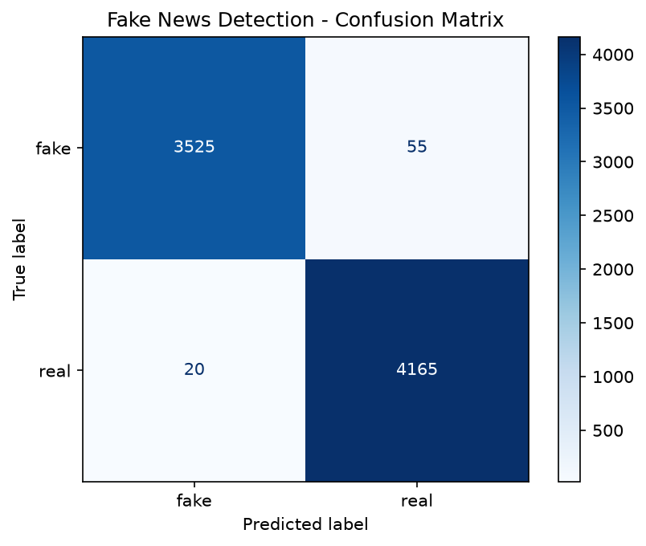

# Fake News Detection

A machine learning system that classifies news articles as **real** or **fake** using TF-IDF features and a LinearSVC classifier.

**Tech stack**: Python, Pandas, Scikit-learn, Matplotlib, Joblib

## Results

Evaluated on a held-out test set of 7,765 articles (20% stratified split).

| Class | Precision | Recall | F1-score | Support |
|-------|-----------|--------|----------|---------|
| Fake  | 0.9944    | 0.9846 | 0.9895   | 3,580   |
| Real  | 0.9870    | 0.9952 | 0.9911   | 4,185   |

**Overall accuracy: 99.03%** | Macro F1: 0.9903



## Dataset

[Fake and Real News Dataset](https://www.kaggle.com/datasets/clmentbisaillon/fake-and-real-news-dataset) (ISOT) by Clément Bisaillon on Kaggle.

- 44,898 articles originally; **38,824** after removing empty and duplicate articles
- Class balance after cleaning: 20,924 real, 17,900 fake

The dataset is not included in this repo because of its size. See the setup steps below.

## Method

1. **Cleaning:** title and text combined, lowercased, URLs and non-letter characters removed.
2. **Leakage control:** the "(Reuters) -" source tag at the start of real articles is removed so the model learns writing patterns rather than a source label. The `subject` and `date` columns are not used.
3. **Deduplication:** duplicate articles are dropped so the same text cannot appear in both train and test sets.
4. **Split:** stratified 80/20 train/test split. The TF-IDF vectorizer is fit on training data only.
5. **Features:** TF-IDF with unigrams and bigrams, English stop words removed, sublinear term frequency.
6. **Model:** LinearSVC.

## Project structure

```
fake-news-detection/
├── data/                  # put Fake.csv and True.csv here (not tracked)
├── train.py               # clean data, train, evaluate, save model
├── predict.py             # classify a piece of text from the command line
├── requirements.txt
└── README.md
```

## Setup and usage

```bash
# 1. Install dependencies
pip install -r requirements.txt

# 2. Download Fake.csv and True.csv from Kaggle and place them in data/

# 3. Train and evaluate
python train.py

# 4. Predict on new text
python predict.py "paste the news text here"
```

`train.py` prints accuracy and a classification report, then saves `model.joblib` and `confusion_matrix.png`.

## Limitations

- The dataset is relatively easy: real and fake articles come from different sources with distinct writing styles, so very high accuracy is expected and partly reflects those style differences.
- The model was trained on a single dataset (mostly US political news from around 2016-2017) and may perform worse on articles from other sources, topics or time periods.
- It detects writing patterns, not factual correctness, so it cannot verify whether a claim is true.

## Future improvements

- Test on a second, independent dataset to measure generalization
- Compare against Logistic Regression, Naive Bayes and a transformer model
- Add a simple web interface for live predictions

## Author

Sweta Mishra | [GitHub](https://github.com/swetasm108-bit) | [LinkedIn](https://linkedin.com/in/sweta-mishra-604612226)
